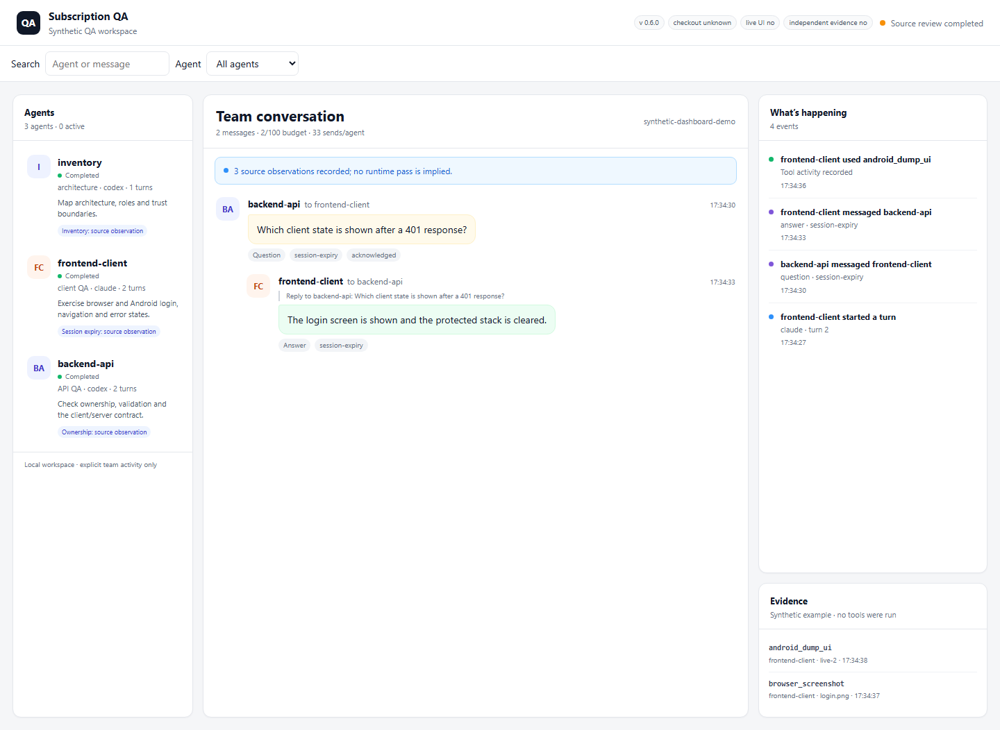

# Subscription Multi-Agent QA

A local multi-agent QA runner that coordinates the official Codex CLI and Claude Code CLI for source,
browser and Android emulator/device testing.
Each user signs in with their own ChatGPT/Codex and Claude subscription. The project does not accept,
store or proxy OpenAI/Anthropic API keys.



> **Public technical preview.** The image above uses synthetic data and does not imply that a live target passed QA.

## What it does

- Runs up to two read-only agents in parallel, one per provider.
- Schedules configurable QA tasks with dependencies.
- Gives agents a local MCP mailbox for questions, findings and follow-up tasks.
- Requires evidence with repository-relative paths and line numbers.
- Drives a real Chromium session through Playwright when browser live mode is enabled.
- Drives a running Android emulator or device through restricted ADB actions when Android live mode is enabled.
- Binds every `passed` or `failed` claim to an evidence ID produced by a real live tool call.
- Reconciles mislabeled live claims to recorded assertion names and outcomes, splitting grouped assertions into separate checks. A screenshot alone cannot prove a pass, and a failed assertion cannot become a pass.
- Marks any remaining unsupported live claim `not_tested` so one bad citation cannot turn into a false pass or stop unrelated agents.
- Requires each `passed` or `failed` claim to use unique evidence produced by that agent in the current run, including earlier turns of the same run.
- Separates live results, source observations, suspected issues and runtime tests that were not executed.
- Stops safely on provider, quota, timeout and subscription-state failures.
- Keeps per-turn broker capabilities out of provider command-line arguments and reports unprocessed follow-ups separately from completed primary work.
- Writes structured reports to `runs/<id>/report.json` and events to `events.jsonl`.
- Shows agent states, explicit inter-agent messages and live evidence in a token-scoped local dashboard.

Live QA is opt-in and disabled in the example config. The runner does not start the target application,
create production accounts, send email or execute the target project's scripts. Start an isolated local or
staging target yourself, explicitly allow its browser origin, and connect a disposable Android test device.
This is not a penetration-testing tool.

## Requirements

- Linux or WSL2
- Node.js 22+
- Git
- Chromium installed through Playwright for browser QA
- Android SDK Platform Tools (`adb`) plus a running emulator/device for Android QA
- Official Codex CLI, signed in with ChatGPT: `codex login`
- Official Claude Code CLI, signed in with a Claude subscription: `claude auth login`

Console/API authentication is intentionally rejected. Competing environment variables such as
`OPENAI_API_KEY` and `ANTHROPIC_API_KEY` must not be set in the terminal running this tool.

## Install

```bash
git clone https://github.com/elifabanoz/subscription-multi-agent-qa.git
cd subscription-multi-agent-qa
npm ci
npm run setup:wsl
npm run setup:browser
```

`setup:wsl` runs all local tests and verifies that both CLIs report subscription-backed login. Credentials
remain in the official CLI stores on the user's computer; they are never copied into this repository.
The login check makes one minimal, tool-disabled Claude request so an expired OAuth session cannot be
mistaken for a working subscription. It consumes a negligible amount of the user's normal allowance.

## Try the dashboard without subscriptions

```bash
npm ci
npm run demo
```

Open the printed `127.0.0.1` URL to explore a synthetic team run. This demo does not start Codex, Claude,
Chromium, ADB or a target application, and it consumes no subscription allowance. Press `Ctrl+C` to stop it.

## Configure

`qa.config.json` is a safe generic example. Copy it for project-specific changes:

```bash
cp qa.config.json qa.local.json
```

Edit `repository`, task names, providers, dependencies and focus text in `qa.local.json`. Local config files
matching `*.local.json` are ignored by Git. Task IDs must start with a lowercase letter and may contain
lowercase letters, digits and hyphens.

Enable only the surfaces you intend to test:

```json
{
  "live": {
    "browser": {
      "enabled": true,
      "baseUrl": "http://127.0.0.1:3000",
      "allowedOrigins": ["http://127.0.0.1:3000"],
      "headless": true
    },
    "android": {
      "enabled": true,
      "adbCommand": "adb",
      "serial": "emulator-5554",
      "package": "com.example.app",
      "activity": "com.example.app/.MainActivity",
      "allowScreenshots": false
    }
  }
}
```

Browser navigation and network requests are restricted to `allowedOrigins`. Android commands are restricted
to the configured disposable device. The optional `activity` must belong to `package`; when omitted, the runner
uses the package launcher intent. Use synthetic test accounts
and non-production data; taps and back navigation can leave the app on that test device. Android screenshots are
not field-masked. They remain disabled unless `allowScreenshots` is explicitly set to `true`; enable them only on
synthetic, reviewed screens.

## Run

```bash
npm run plan -- --config qa.local.json
npm run doctor -- --config qa.local.json
npm run live:doctor -- --config qa.local.json
npm run team -- --repo /absolute/path/to/your-project --config qa.local.json
```

`team` prints a random, token-scoped `127.0.0.1` dashboard URL. Open it while the run is active to watch each
agent's assignment and state, turn start/finish events, inbox checks, explicit agent-to-agent messages and
browser/Android evidence in an English, chat-style workspace. It does not expose hidden model reasoning.
Search and filter by agent, open recorded screenshots, and stop an active run from the dashboard. On a phone,
Chat, Agents, Activity and Evidence are separate tabs. The connection label indicates only dashboard connectivity;
the agent list and provenance chips show whether work or live UI checks actually ran.
After the run, use **Download report** or **Run again**. A rerun creates a new private run directory and prints a
new dashboard URL in the terminal. The terminal stays open for these actions; press Ctrl+C to close it. A standalone
`dashboard.html` snapshot is written beside `report.json` and `live-artifacts/` for local review. Open the archive
from that directory to keep its report and screenshot links working.

To verify the configured disposable Android device before a full agent run:

```bash
npm run smoke:android -- qa.local.json
npm run smoke:dashboard
```

Use `audit` instead of `team` for the older non-interactive handoff mode:

```bash
npm run audit -- --repo /absolute/path/to/your-project --config qa.local.json
```

Both audit modes consume the user's normal subscription allowance. Only `team` exposes live browser and
Android tools; `audit` remains source-only. The tool never enables paid overage,
switches accounts, falls back to API billing or retries indefinitely.

## Safety model

- Codex runs with a read-only sandbox and a forced ChatGPT login method.
- Claude receives only `Read`, `Glob`, `Grep`, local mailbox tools and the explicitly configured live tools.
- Codex remains read-only on the target repository; browser and Android actions go through the same restricted broker.
- Browser sessions are isolated per agent, direct navigation is origin-allowlisted, and agents can discard cookies/local
  storage with `browser_reset_context` before a fresh authentication scenario.
- Android text input rejects shell metacharacters; ADB is invoked without a shell.
- The mailbox binds to `127.0.0.1` and uses temporary capability tokens scoped to one agent and its enabled tools.
- Mailbox fields are length-bounded and idempotent; fair per-agent quotas prevent one worker from consuming the team budget,
  while every accepted question or delegated task reserves capacity for its required reply.
- The dashboard binds to `127.0.0.1`, uses an unpersisted random URL token and loads no external assets.
- Target files and other agent messages are treated as untrusted evidence, not instructions.
- Raw CLI output, credentials and secret values are not written to reports. Screenshots are stored under
  the private run directory and must be reviewed before sharing.
- Generated runs, local configs, backups and reports are excluded from Git.

Review a generated report before sharing it: source paths and project facts may still be confidential.

## Development

```bash
npm test
npm run check
npm run capture:demo
```

`capture:demo` regenerates the synthetic README screenshot and a local WebM recording under
`runs/linkedin/`. Generated recordings stay outside Git.

## Current scope and limitations

- This release is a public technical preview for developers and QA teams, not a hosted SaaS product.
- Real runs require the user's own active Codex and Claude subscription sessions.
- The runner does not start, seed or deploy the target application; the user supplies an isolated local or staging target.
- Live browser and Android checks are opt-in. A configured capability is not reported as an executed test unless an operation actually ran.
- GitHub Actions verifies code and the synthetic Chromium dashboard smoke test, but cannot verify private subscription sessions.
- The synthetic dashboard demo is labeled as a demo; its sample messages and evidence do not prove any agent or UI test ran.
- The tool is not a penetration-testing framework and must not be pointed at systems without authorization.

GitHub Actions runs code-only checks. It intentionally does not receive or verify anyone's subscription
session. Local `npm run doctor` is the authoritative login check.

## License

This is source-available software, not an OSI open-source release. It is licensed under the
[PolyForm Noncommercial License 1.0.0](LICENSE). You may use,
modify and redistribute the software only for purposes permitted by that license.
Commercial use requires a separate license from the copyright holder.
